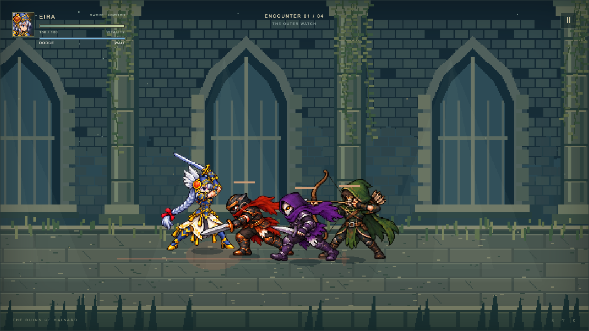
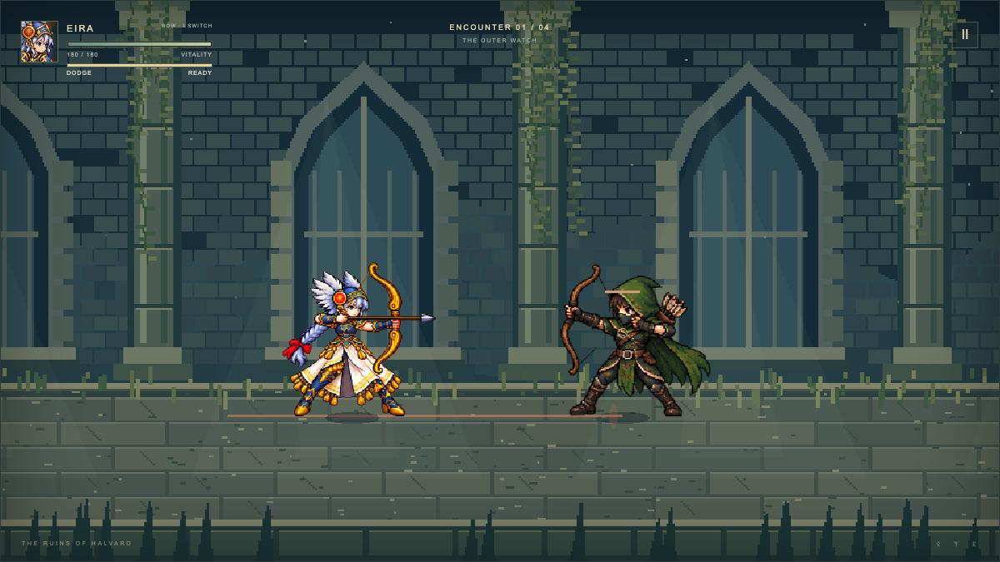
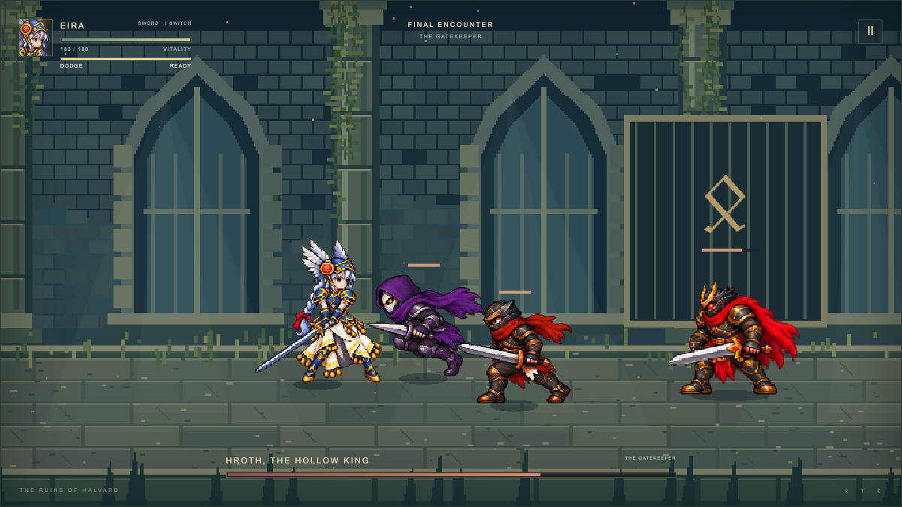
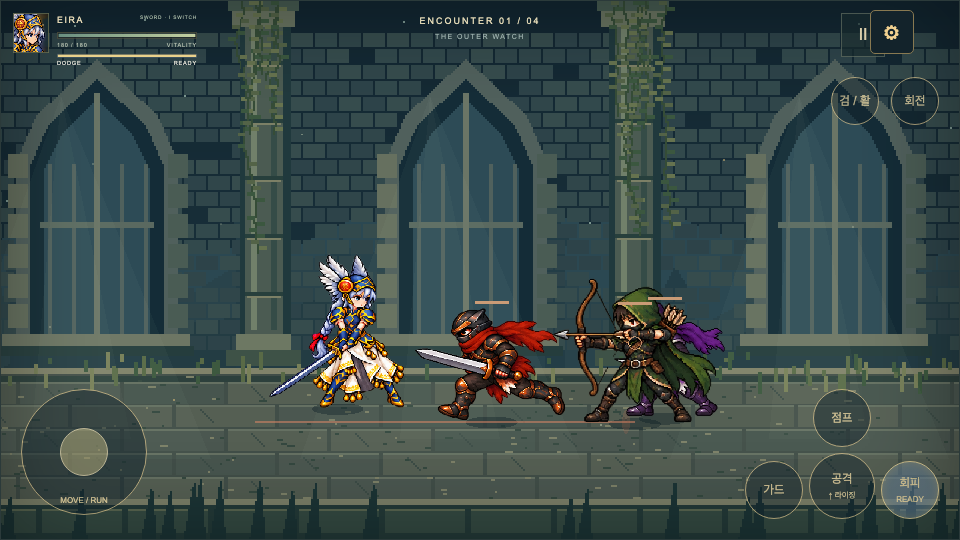

# VALKYRIE — The Ashen Gate

A single-player 2.5D arcade action game. Play as Eira, a silver-haired Valkyrie, and fight through a ruined corridor to defeat the Hollow King. Built with Phaser 3, TypeScript and Vite; runs in the browser without an account or backend.

**[Play now](https://hyangdan2.github.io/CDXPilot0005/)** · [Animation preview](https://hyangdan2.github.io/CDXPilot0005/sd-review.html) · [Changelog](docs/CHANGELOG.md)



_Sword combat — face melee fighters and archers in the ruined corridor._

## Features

- A four-hit sword combo with increasing damage, attack windups and interruption on hit.
- Sword and bow switching, directional guarding, jumping, rising attacks and an armored spin special. Bow shots have a deliberate draw time and recovery; bow guarding absorbs less damage than sword guarding.
- Dodge rolls with a visible recharge meter, plus limits on repeated aerial juggling.
- A widened opening courtyard with a breakable barricade and a furnace vent that warns before burning. Detour or break through, and use jumping or timed dodge rolls to avoid fire.
- A stone cloister with alternating S-shaped passages and permanent arrow-blocking cover. Archers reposition for a clear lane, and stone fades when it would hide actors.
- Three regular encounters and a boss fight, with distinct melee and archer roles. The boss calls reinforcements as its health falls.
- SD character animation, synthesized medieval-style music, and separate victory and defeat themes.
- Keyboard controls and landscape touch controls, with audio and touch layout settings in the top-right menu.

| Bow Combat                                                                       | Boss Encounter                                                                          |
| -------------------------------------------------------------------------------- | --------------------------------------------------------------------------------------- |
|  |  |
| Commit to a deliberate draw before releasing an arrow.                           | Manage approaching reinforcements while facing the Hollow King.                         |

## Controls

### Keyboard

| Input                             | Action                                                          |
| --------------------------------- | --------------------------------------------------------------- |
| WASD / Arrow keys                 | Move horizontally and along the arena's depth                   |
| Double-tap a direction, then hold | Run                                                             |
| J                                 | Sword attack / fire bow                                         |
| I                                 | Switch sword and bow                                            |
| Hold K                            | Guard in the facing direction                                   |
| L                                 | Dodge roll                                                      |
| Space                             | Jump                                                            |
| J while airborne                  | Air attack                                                      |
| Down → Forward → J                | Rising attack; forward follows the character's facing direction |
| J + K together                    | Armored spin special                                            |
| Esc                               | Pause / resume                                                  |
| F1                                | Toggle debug overlay                                            |

Press J again near the end of a strike to continue the sword combo. Taking a hit resets the chain. Match an enemy's depth before attacking and watch for attack telegraphs.

The dodge meter beneath HP recharges after each roll. **READY** means rolling is available; **WAIT** means an action or airborne state temporarily prevents it, even at full charge.

For the spin special, release both J and K first, then press them together while grounded and idle, walking or running. Current HP must exceed 20% of maximum HP. The first hit costs 20% of maximum HP once per use; a miss does not charge that cost.

There is no automatic healing between encounters. Defeated enemies have a small chance to drop a healing potion. Defeating the boss ends the stage, including any remaining reinforcements.

### Touch

Rotate the device to landscape to show controls over the game. Use the left stick to move; push toward its outer edge to run. Tap the attack button to strike or shoot, or swipe upward from it for a rising attack. Separate buttons handle guard, jump, dodge, weapon switching and the spin special.

Portrait orientation pauses play and displays a rotation prompt. Return to landscape and resume manually. The settings menu adjusts control size, opacity and inset. Browser pan and zoom gestures are suppressed over the game area.



_Landscape touch controls — movement on the left, combat actions on the right._

## Getting Started

Requires **Node.js 22.13 or newer** and npm. The repository includes an `.nvmrc` for Node 22.

```bash
npm ci
npm run dev
```

Open the URL printed by Vite, normally `http://localhost:5173/`.

To build and preview the production version:

```bash
npm run build
npm run preview
```

The build is written to `dist/`. Serve it over HTTP rather than opening its HTML file directly.

## Development

| Command                | Purpose                                                                             |
| ---------------------- | ----------------------------------------------------------------------------------- |
| `npm run verify`       | Check environment and assets, lint, typecheck, run unit/integration tests and build |
| `npm run test`         | Run Vitest tests                                                                    |
| `npm run test:e2e`     | Build and run Playwright browser tests                                              |
| `npm run assets:check` | Validate generated assets and metadata                                              |

Install Chromium before the first local E2E run:

```bash
npx playwright install chromium
npm run test:e2e
```

Run `verify` and `test:e2e` sequentially: both write to `dist/`. E2E reports and screenshots are saved in `playwright-report/` and `test-results/`. See the [QA record](docs/QA.md) for test coverage and limitations.

### Project structure

| Path                                               | Responsibility                                         |
| -------------------------------------------------- | ------------------------------------------------------ |
| `src/data/`                                        | Attack definitions, encounters and reinforcement rules |
| `src/game/entities/`, `combat/`, `ai/`, `physics/` | Deterministic simulation and combat                    |
| `src/game/scenes/`, `animation/`, `camera/`, `ui/` | Phaser presentation, animation, interface and audio    |
| `src/game/input/`                                  | Keyboard and touch input translation                   |
| `public/assets/`                                   | Runtime art and audio                                  |
| `art/generated/`, `scripts/`                       | Preserved artwork sources and asset tooling            |
| `tests/`                                           | Unit, integration and browser tests                    |

The simulation runs at 60 Hz and remains independent of Phaser and the DOM. Current SD character frames include their weapons. Asset regeneration and registration details belong in the [art pipeline guide](docs/ART_PIPELINE.md).

## Deployment

The game is hosted on **GitHub Pages**. The [Verify and deploy workflow](.github/workflows/ci.yml) runs verification and browser tests before publishing `dist/` on pushes to `main`. Pull requests run checks without deploying. The workflow can also be started manually.

For a fork, select **GitHub Actions** as the Pages deployment source and allow the `github-pages` environment to deploy. Relative asset URLs support hosting beneath a repository subpath.

[View workflow runs](https://github.com/HyangDan2/CDXPilot0005/actions/workflows/ci.yml)

## Documentation and Limitations

- [Architecture](docs/ARCHITECTURE.md)
- [Maintenance](docs/MAINTENANCE.md)
- [Art pipeline and provenance](docs/ART_PIPELINE.md)
- [Current Eira artwork and gameplay update](docs/art/READINESS_V12.md)
- [QA record](docs/QA.md)
- [Changelog](docs/CHANGELOG.md)

The current scope is one single-player stage, with no save system, gamepad support or multiplayer. Character artwork uses AI-generated key poses; small ornament and limb differences remain between frames. Music and sound effects are synthesized.

Automated browser checks cover Chromium, including mobile touch emulation. Physical iOS/Android devices and other browser engines have not been verified. Some in-game labels and supporting documents remain in Korean.
