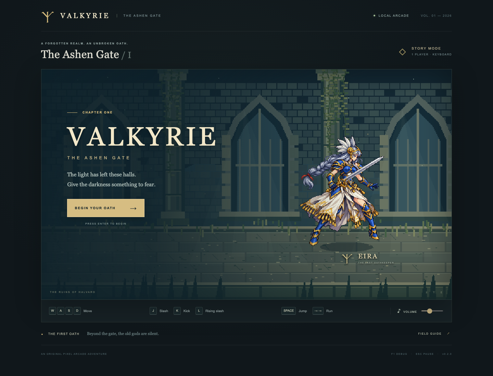

## v0.4.0 · 양손검 커맨드 전투

J 공격 · K 검 가드 · ↓앞J 라이징(400ms) · J+K 회전 필살기(40ms 이내, 양 키 해제 후 지상 대기/이동에서만). 필살기는 첫 적중 때 최대 HP20%를 한 번 차감합니다. 자동 회복 대신 적당5% 확률로10/20/50% 회복약이 드롭됩니다. 중세풍 오리지널 합성 BGM2곡과 독립 음량 조절을 추가했습니다. [제작·검증 기록](docs/art/TWOHAND_V4.md).

## SD v0.3.0

SD player and all four enemy roles now include their weapons in the sprite. Attacks use pose-linked collision envelopes; enemies pursue and re-engage faster. Run `npm run assets:pack-sd` to repack preserved sources. Open `/sd-review.html` for slow playback and frame inspection. Details and limitations: [SD v3](docs/art/SD_V3.md).

# VALKYRIE — The Ashen Gate

오리지널 2.5D 픽셀 벨트스크롤 액션 MVP. 은발의 발키리 **Eira**가 폐허의 회랑을 통과해 Hollow King을 쓰러뜨립니다. Phaser 3 + TypeScript strict + Vite로 구현했으며 서버·계정·외부 API가 필요 없습니다.



## v0.2 아트·전투 업데이트

제공된 참고 아트 기반의 Eira 몸체 11개 시트 / **72개 독립 포즈**, 고해상도 전신·얼굴 초상·독립 장검을 적용했습니다. `art/generated/`에 생성 원본을 보존하고, 게임용은 384×384 캔버스로 정렬합니다. `npm run assets:generate`는 이 새 아트를 덮어쓰지 않습니다. 재패킹은 `npm run assets:pack-eira`입니다.

개발 서버의 [아트 검수 페이지](http://localhost:5173/art-review.html)에서 동작별 프레임과 게임 크기를 비교할 수 있습니다. 배포 환경에서도 `art-review.html`을 열 수 있습니다.

달리기는 같은 방향을 **250ms 내 두 번 누르고 유지**하며, 키를 놓거나 공격/가드/피격 시 종료됩니다. Shift는 달리기에 사용하지 않습니다. 적은 측면 이동·짧은 대시·공격 후 이탈·재진입으로 압박하고, 예고가 시작된 공격은 방향을 고정합니다.

공중 콤보는 적별로 관리합니다. 첫 띄우기 100%, 두 번째 35%, 세 번째 띄우기 또는 추가 공중 타격 3회 도달 시 강제 다운합니다. 다운·기상 중에는 재타격할 수 없고, 기상 완료 후 0.5초 보호합니다. 보스는 띄우기 대신 짧은 경직만 받습니다.

[아트 제작 기록](docs/art/UPGRADE_QA.md) · [생성 프롬프트](docs/art/PROMPTS.md)

## 실행

**Node.js 22.13 이상**과 npm이 필요합니다. 기존 시스템 Node 16으로는 Vite가 실행되지 않습니다. `.nvmrc`에 Node 22가 지정되어 있습니다.

```bash
nvm install 22   # nvm을 사용하는 경우
nvm use
npm install
npm run dev
```

출력되는 로컬 URL(기본 `http://localhost:5173`)을 엽니다. `npm run build`는 `dist/`를 만들고, `npm run preview`로 배포 빌드를 볼 수 있습니다. 로컬 HTML 파일을 직접 더블클릭하지 마세요. npm 외 글로벌 패키지는 필요 없습니다.

## 플레이

| 입력                   | 동작                                         |
| ---------------------- | -------------------------------------------- |
| WASD / 방향키          | 지면의 좌우·깊이 이동                        |
| J                      | 검 베기, 회복 구간에서 다시 J로 두 번째 베기 |
| K                      | 양손검 가드                                  |
| ↓앞J                   | 커맨드 올려치기                              |
| Space / 공중 J         | 점프 / 공중 공격                             |
| 같은 방향 두 번 + 유지 | 달리기 (WASD / 방향키, 250ms 이내)           |
| J+K                    | 회전 필살기                                  |
| Esc / F1               | 일시정지 / 디버그                            |

동일한 깊이에 선 적에게 `J → J → ↓앞J`을 연결하세요. 후속 공격은 앞 공격의 유효 구간이 끝날 무렵 누르면 됩니다. 공격 입력은 200 ms 동안 버퍼링됩니다. 적의 붉은 예고 영역을 위아래로 피하세요. 웨이브 종료 후 자동 회복 없이 오른쪽 다음 구역으로 이동합니다. 회복약은 적 사망 시 5% 확률로 드롭됩니다. 보스 체력 50% 이하에서는 이동·돌진 속도와 패턴이 강화됩니다.

3개 일반 웨이브 + 보스, 총 13명. 타이틀의 Begin 버튼이나 Enter로 시작하고, Pause 메뉴에서 재시작할 수 있습니다. 볼륨 슬라이더의 0은 음소거입니다. 브라우저 오디오가 차단되어도 게임은 계속됩니다. 터치 조작은 제공하지 않으며 데스크톱 키보드를 권장합니다.

## 검증 명령

```bash
npm run verify               # 환경 → PNG 검사 → lint → strict 타입 → Vitest → build
npx playwright install chromium
npm run test:e2e             # production build + 실제 Chromium; /valkyrie/ 하위 경로 검증
npm run test                 # 단위/통합/입력 기반 전체 스테이지 클리어
npm run lint
npm run typecheck
npm run assets:generate      # 원본 코드에서 PNG/metadata 재생성
npm run assets:check
```

E2E 결과는 `playwright-report/`, 스크린샷·실패 trace는 `test-results/`에 생성됩니다. 대표 화면은 `docs/screenshots/`에 보관합니다. E2E 결과 화면용 fixture는 `?test=1`에서만 노출되며 일반 URL에는 없습니다. 실제 키 입력 전투 검사와 결과 fixture 검사는 구분되어 있습니다. [검증 기록](docs/QA.md)을 참고하세요.

## 구조

- `src/data/`: 공격 수치, 웨이브 구성
- `src/game/entities/`: 순수 시뮬레이션·FSM·이동·액터
- `src/game/combat/`, `ai/`, `physics/`: 전투, 결정적 AI, XYZ/고정 timestep
- `src/game/animation/`: 몸체 프레임, 독립 검 리그, 에셋 fallback
- `src/game/scenes/`: Phaser 어댑터, 월드 렌더러, 테스트 접근점
- `src/game/input/`, `camera/`, `ui/`: 입력, 카메라, HTML UI/합성 오디오
- `scripts/`: 환경·이미지 생성/추출/정렬/검사, 하위 경로 정적 서버
- `tests/`: Vitest 단위·통합, Playwright 브라우저 검사
- `public/assets/`: 오리지널 PNG 8개 + manifest, 오디오/이펙트는 런타임 생성

## GitHub Pages 배포

이 폴더는 원래 Git 저장소가 아니었습니다. **원격 저장소 생성·push·실제 Pages 배포는 아직 수행하지 않았습니다.** 아래는 사용자가 저장소를 만든 뒤의 절차입니다.

1. GitHub에 저장소를 생성하고 이 폴더를 `main` 브랜치로 push합니다. `node_modules`, `dist`, 테스트 리포트는 커밋하지 않습니다. PNG와 lockfile은 커밋합니다.
2. 저장소 Settings → Pages → Build and deployment에서 **GitHub Actions**를 선택합니다.
3. Actions 실행을 허용합니다. 조직 정책이 있다면 `github-pages` environment의 배포 권한도 허용합니다.
4. `main` push 또는 Actions의 수동 실행으로 검증 → E2E → Pages artifact 업로드 → 배포가 진행됩니다. PR에서는 배포하지 않습니다.
5. 성공한 deploy job의 URL에서 시작·오디오·재시작을 확인합니다. 기본 주소는 `https://<owner>.github.io/<repo>/`입니다.

Vite `base: './'`, 모든 로더의 `import.meta.env.BASE_URL`과 상대 URL로 하위 경로를 지원합니다. E2E는 실제 `dist` 파일을 `/valkyrie/`에 마운트해 이를 검사합니다. remote Actions 실행/권한/DNS는 로컬 검증 대상이 아닙니다.

## 문서와 한계

[아키텍처](docs/ARCHITECTURE.md) · [Harness](docs/HARNESS.md) · [유지보수](docs/MAINTENANCE.md) · [아트 파이프라인](docs/ART_PIPELINE.md) · [게임 디자인](docs/GAME_DESIGN.md) · [계획](docs/IMPLEMENTATION_PLAN.md) · [변경 이력](docs/CHANGELOG.md)

초기 버전은 절차적 아트로 제작했으며, v0.2의 주인공은 이후 제공된 참고 아트에 기반해 내장 이미지 생성 도구로 제작했습니다. 적과 배경은 기존 절차적 아트를 유지합니다. 주인공은 AI 생성 키포즈 애니메이션이며 수작업 보간 애니메이션과 동일한 완성도를 주장하지 않습니다. 효과와 음악은 자체 합성입니다. 키보드 싱글플레이 1개 스테이지이며 저장·게임패드·터치·멀티플레이는 없습니다. 브라우저 자동화는 Chromium만 검증했습니다.
